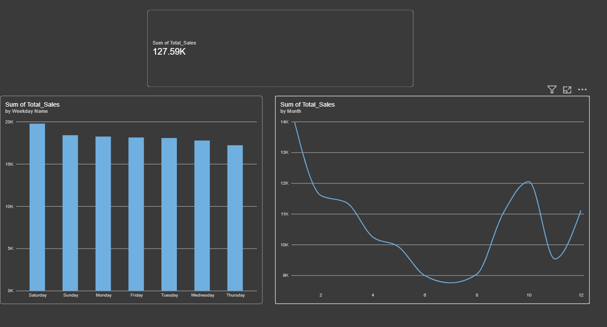

# 📊 Pharmaceutical Sales Data Analysis

An end-to-end data analytics project exploring retail pharmaceutical transactions to track temporal sales distributions and evaluate demand cycles across drug classifications.

---

## 📈 Dashboard Preview


---

## 🛠️ Tech Stack & Libraries
* **Language:** Python 3.11
* **Data Manipulation:** Pandas, NumPy
* **Data Visualization:** Matplotlib, Seaborn
* **Business Intelligence:** Power BI Desktop

---

## 📁 Repository Structure
```text
├── data/
│   └── salesdaily.csv              # Raw pharmaceutical transactional records
├── notebooks/
│   └── pharmaceutical_analysis.ipynb # Jupyter notebook executing data cleaning & EDA
└── dashboards/
    ├── pharma_sales_dashboard.pbix # Interactive Power BI report file
    └── dashboard_preview.png       # Captured preview image of the visual dashboard
```
https://roadmap.sh/projects/pharmaceutical-sales-data
---

## 🔍 Key Data Insights & Exploration

### 1. Data Integrity Audit
* **Dataset Scale:** Evaluated **2,106 complete transaction entries** spanning across multiple fiscal years.
* **Data Quality:** Verified **0 missing or null values** across all 13 tracking attributes, ensuring optimal baseline modeling accuracy.

### 2. Weekly Transaction Distributions
Our exploratory data analysis reveals strong cyclical behavioral purchasing patterns across the calendar week:
* **Peak Sales Volatility:** **Saturday** yields the highest consumer transaction rates, averaging **65.67 units** sold.
* **Sales Troughs:** **Thursday** records the lowest performance margin, dipping to an average of **57.18 units**.

---

## 🚀 Installation & Local Replication

To explore this workspace locally, clone this repository and initialize the Python dependencies:

1. Clone the project files:
   ```bash
   git clone https://github.com
   ```
2. Navigate into the directory:
   ```bash
   cd pharmaceutical-sales-analysis
   ```
3. Run the interactive notebook via VS Code or Jupyter:
   ```bash
   jupyter notebook notebooks/pharmaceutical_analysis.ipynb
   ```

